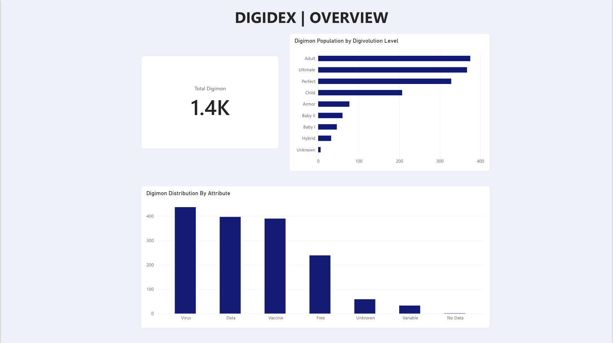
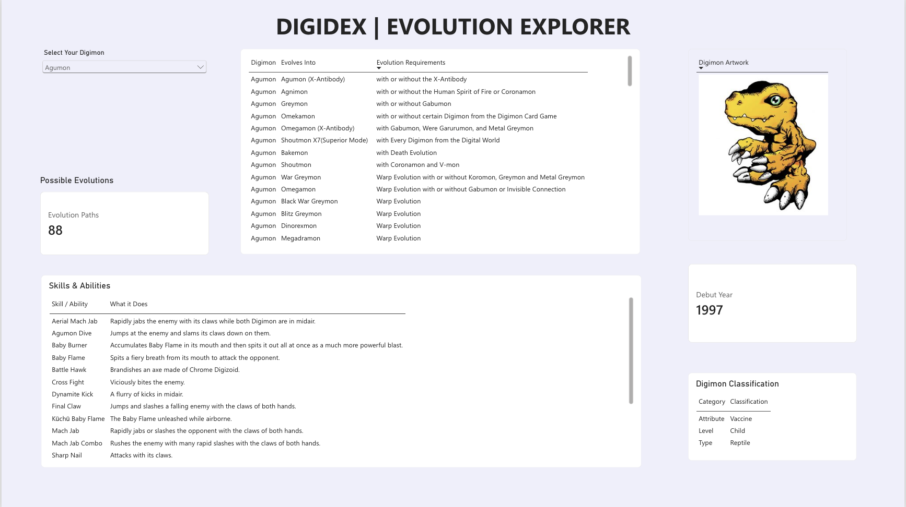
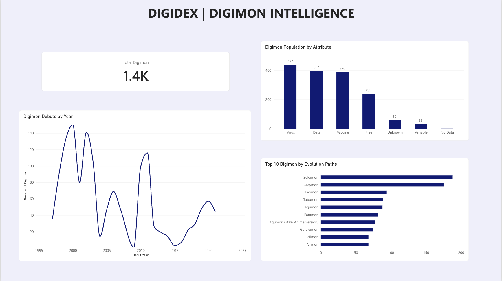

# DigiDex | Evolution Intelligence

### An Interactive Power BI Analytics Project

DigiDex is an interactive Power BI report designed to explore the Digimon universe through data analytics, evolution relationships, classifications, skills, and historical trends.

The project transforms interconnected Digimon datasets into a three-page analytical report, allowing users to explore individual Digimon while identifying broader patterns across the dataset.

## Project Objectives

- Analyze the distribution of Digimon by evolution level and attribute.
- Explore evolution pathways and their associated requirements.
- Create an interactive Digimon explorer featuring artwork, skills, and classifications.
- Examine historical debut trends and identify Digimon with the most evolution connections.
- Demonstrate data modeling, visualization, and analytical storytelling using Power BI.

## Report Pages

### 1. Digivolution Explorer — Overview

Provides a high-level overview of the Digimon dataset, including total Digimon, population by evolution level, and attribute distribution.

### 2. Evolution Explorer

Allows users to select an individual Digimon and dynamically explore its evolution paths, requirements, skills, artwork, debut year, and classifications.

### 3. Digimon Intelligence

Examines historical debut trends, attribute populations, and the top 10 Digimon ranked by recorded evolution paths.

## Data Model

The Power BI report uses four connected tables:

- **DimDigimon:** Core Digimon information
- **evolutions:** Evolution relationships and requirements
- **classifications:** Digimon levels, attributes, and types
- **skills:** Skills and ability descriptions

The tables are connected through Digimon identifiers to support interactive analysis.

## Tools and Skills

**Tools:** Microsoft Power BI, Power Query, DAX, GitHub

**Skills demonstrated:** Data modeling, relational data analysis, interactive filtering, data visualization, dashboard design, and analytical storytelling.

## Project Highlights

- Approximately 1,400 Digimon records represented in the report.
- Interactive exploration of evolution relationships.
- Dynamic artwork, classifications, and skill information.
- Historical analysis of Digimon debuts.
- Three-page report designed for both exploration and analytical insights.

## Power BI Report

The Power BI report file is available in this repository as `DigiDex Evolution Intelligence Dashboard.pbix` inside the `screenshots` folder.

## Future Improvements

Potential enhancements include additional evolution-network visualizations, expanded data coverage, and more advanced analytical measures.

